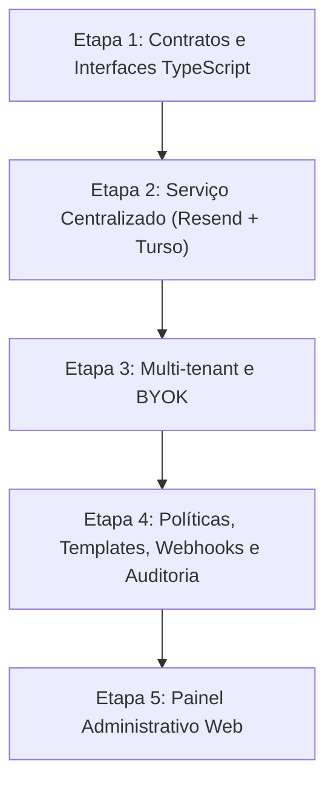

# Todoku — Communication Hub

O **Todoku** é uma plataforma centralizada de orquestração de comunicações projetada para atender a múltiplas aplicações a partir de uma arquitetura unificada.

Seu principal objetivo é evitar a redundância de implementação em cada serviço consumidor, abstraindo o envio de mensagens, gerenciamento de templates, aplicação de políticas, agendamento, rastreamento de entrega e auditoria.

---

> [!NOTE]
> **Status atual do projeto:** Next.js 16, React 19, TypeScript 6 e Node 24, com ingestão durável no Turso, templates versionados, BYOK criptografado, worker autenticado e webhooks assinados do Resend. **O processamento padrão é dry-run, sem envio externo; marketing está desabilitado.** Testes reais exigem configuração por tenant/aplicação, domínio verificado, destinatário autorizado, orçamento de envio e liberação explícita no servidor. Consulte [docs/API.md](docs/API.md), [docs/DELIVERY.md](docs/DELIVERY.md) e [docs/OPERATIONS.md](docs/OPERATIONS.md). Preferências avançadas e painel continuam no roadmap.

---

**Todoku Mail — MVP 1:** webmail em `/mail`, com login real, grants por identidade, caixa unificada, filtros, leitura segura, threads e anexos autenticados. O piloto está **pausado**, sem alteração de DNS ou recebimento externo. R2 privado testado com PUT/GET/DELETE reais, chave restrita ao bucket e configuração de servidor Vercel pronta. Domínio/webhook Resend preparados; Receiving aguarda autorização explícita. Veja [docs/MAIL.md](docs/MAIL.md) e [preparação do piloto](docs/MAIL-ACTIVATION.md).

## 1. Fluxo Conceitual

A arquitetura do Todoku baseia-se na separação entre a geração do evento pela aplicação de origem e a execução da entrega ao destinatário:

$$\text{Aplicação} \longrightarrow \text{Evento} \longrightarrow \text{Todoku} \longrightarrow \text{Provedor} \longrightarrow \text{Destinatário}$$

1. **Aplicação:** Dispara uma intenção de comunicação (ex.: boas-vindas, confirmação de pedido, alerta de segurança).
2. **Evento:** Carga de dados tipada e estruturada enviada via API para o Todoku.
3. **Todoku:** Aplica regras de negócio, deduplicação, resolução de templates, políticas de tenant, preferência do usuário e enfileiramento.
4. **Provedor:** Serviço especializado de transporte contratado ou configurado para a entrega física da mensagem.
5. **Destinatário:** Usuário final recebendo a comunicação no canal solicitado.

---

## 2. Decisões Arquiteturais Estabelecidas

- **Canal inicial:** E-mail.
- **Provedor inicial:** [Resend](https://resend.com/).
- **Extensibilidade multicanal e multiprovedor:** Arquitetura desacoplada via adaptadores (interfaces), permitindo plugar novos provedores de e-mail ou canais futuros (SMS, WhatsApp, Webhooks, Push Notifications) sem impacto nas aplicações consumidoras.
- **Multi-tenant com isolamento estrito:** Segmentação por aplicação e cliente, garantindo que configurações, templates, logs e métricas permaneçam completamente isolados.
- **BYOK (Bring Your Own Key):** Suporte para que cada aplicação ou tenant forneça suas próprias credenciais de API do provedor (ex.: chave Resend própria e domínios autenticados), mantendo conformidade e custos individualizados.
- **Onboarding de credenciais auxiliado por MCP:** Mecanismos de automação e assistência guiada via Model Context Protocol (MCP) para agilizar o setup de credenciais, domínios e chaves de envio.
- **API para integração com aplicações consumidoras:** Endpoints padronizados para ingestão de eventos síncronos e assíncronos.
- **Templates versionados e reutilizáveis:** Catálogo centralizado de templates com versionamento semântico, pré-visualização e injeção dinâmica de variáveis.
- **Políticas de envio e preferências dos destinatários:** Gestão de opt-out/cancelamento de inscrição, limites de taxa (*rate limiting*), janelas de entrega e controle de frequência (*anti-fatigue*).
- **Agendamento, filas e processamento assíncrono:** Capacidade de agendar mensagens para datas futuras e processar grandes volumes com garantias de resiliência.
- **Idempotência e deduplicação de eventos:** Chaves de idempotência para garantir que falhas transitórias de rede ou reenvios da aplicação não resultem em mensagens duplicadas para o destinatário.
- **Histórico e auditoria:** Registro imutável de todas as mensagens processadas, payloads de evento, tentativas de envio e metadados de entrega.
- **Webhooks de eventos:** Ingestão de webhooks dos provedores para registrar eventos do ciclo de vida da mensagem (envio, entrega, abertura, clique, rejeição e reclamação de spam).
- **Separação de tráfego:** Isolamento rígido entre e-mails transacionais (prioridade alta, entrega imediata) e campanhas de marketing ou notificações em lote.

---

## 3. Direção Tecnológica

A pilha tecnológica do Todoku é composta por:

- **Linguagem & Runtime:** Node.js e TypeScript para segurança de tipos em contratos de eventos.
- **Camada Web & API:** Next.js para API de ingestão, visualização de templates e futura interface de gerenciamento.
- **Persistência:** [Turso](https://turso.tech/) (libSQL / SQLite distribuído no Edge) para armazenamento de configurações, tenants, templates e logs de auditoria.
- **Entrega de E-mails:** Resend API.

### Evolução Incremental (Roadmap)

1. **Etapa 1:** Definição dos contratos de eventos, esquemas de validação e interfaces TypeScript.
2. **Etapa 2:** Implementação do serviço centralizado conectando Resend e persistência básica no Turso.
3. **Etapa 3:** Camada multi-tenant com suporte completo ao modelo Bring Your Own Key (BYOK).
4. **Etapa 4:** Motor de templates versionados, ingestão de webhooks, deduplicação e trilha de auditoria.

**Trilha Mail:** Receiving do piloto validado em produção. MVP 2 adiciona composição, respostas, rascunhos e lixeira; envio externo segue bloqueado até autorização específica. Detalhes em [docs/MAIL.md](docs/MAIL.md) e [plano de Sending](docs/MAIL-OUTBOUND.md).
5. **Etapa 5:** Painel administrativo para acompanhamento operacional, métricas de envio e configuração de tenants.

---

## 4. Aplicações Consumidoras Previstas

O Todoku foi planejado para atender como hub de comunicação do ecossistema de projetos:

- **MinhaNota**
- **Viva João Pessoa**
- **Imobiliária Pé na Areia**
- **Ride4x4**
- **Kindred Veil**
- Novas aplicações futuras

---

## 5. Domínio e Infraestrutura

- **Domínio oficial:** `todoku.com.br`
- **DNS:** Gerenciado via Cloudflare.
- **Segurança de E-mail:** MX Receiving e DKIM do Resend verificados no piloto; SPF defensivo e DMARC preservados. Sending requer aprovação e revisão dos registros outbound exatos. Histórico em [docs/MAIL-ACTIVATION.md](docs/MAIL-ACTIVATION.md).
