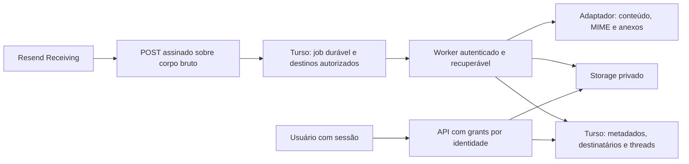

# Todoku Mail — MVP 1

> MVP 3, entrega 2: [contrato das APIs administrativas](MAIL-ADMIN-API.md), separado de autenticação, conteúdo e provisionamento externo.

> Atualização MVP 3: [autorização administrativa e conteúdo](MAIL-AUTHORIZATION.md) acrescenta `0007`, memberships, papéis por escopo, leitura explícita e autoria de rascunhos. O histórico do MVP 1 abaixo não representa o estado atual de ativação; consulte também o [plano incremental](MAIL-MVP3-PLAN.md).

> O estado abaixo registra a implantação original do MVP 1. O fluxo real de envio e resposta foi validado na [issue #15](https://github.com/mtcporto/todoku/issues/15#issuecomment-6660956829). A primeira entrega do MVP 3 acrescenta [auditoria e proposta de migração](MAIL-MVP3-AUDIT.md) e [Google OIDC opcional](MAIL-GOOGLE-OIDC.md), mantendo o login atual e os limites de envio.

O Mail recebe e lê mensagens de identidades próprias em uma caixa unificada, separado de Notifications. Inclui login real, grants por identidade, filtros por domínio/identidade, paginação, leitura formatada ou em texto, threads por referências e download autenticado de anexos. Não implementa encaminhamento ou resposta/envio real.

## Estado verificado do piloto

Em 04/11/2026, o piloto usa o banco único `todoku`. O bucket R2 privado `todoku-mail` e o domínio/webhook Resend exclusivo foram provisionados na fase A da issue #12. Buckets e domínios de outros projetos não foram modificados ou reutilizados.

O piloto tem cadastros preparatórios `contato@todoku.com.br` e `suporte@todoku.com.br`, com source, domínio e identidades **desativados**. A inbox publicada começa vazia. `TODOKU_MAIL_RECEIVING_ENABLED=false` e `TODOKU_MAIL_STORAGE=r2` são explícitos nos ambientes Vercel após o provisionamento da fase A. Notifications mantém `TODOKU_TEST_SEND_ENABLED=false`, marketing desabilitado e credenciais do teste anterior revogadas.

**PUT/GET/DELETE remotos passaram com bytes sintéticos, eliminados ao final.** A credencial foi restrita ao bucket e configurada no servidor Vercel, com negação de acesso a outro bucket verificada. Receiving e o webhook continuam desativados; não se declara recebimento externo funcionando nesta etapa. Inventário DNS, prova remota, gate externo e reversão estão em [MAIL-ACTIVATION.md](MAIL-ACTIVATION.md).

## Arquitetura e processamento



A migração aditiva `0003_mail` cria usuários, sessões, limites de login, sources BYOK, domínios, identidades/grants, jobs de ingestão, mensagens, destinatários, threads, anexos, manifesto de objetos e auditoria append-only. Dados operacionais têm FKs compostas por tenant. Domínios e endereços são únicos e provisionados pelo operador. A API deriva permissões da sessão; IDs do cliente nunca concedem acesso.

`POST /api/webhooks/mail/resend/<source-id>` verifica assinatura Svix e timestamp sobre corpo original limitado a 64 KiB. Usa destinos de envelope `received_for`, com fallback para `to` quando ausentes, e aceita somente identidades ativas vinculadas ao source autenticado. Remetente, assunto e headers não autenticam usuários. Destinos desconhecidos geram job rejeitado, sem download. Quotas iniciais: 100 eventos/source em 24h e 100 jobs pendentes/tenant; excesso retorna 429.

O 200 reconhece persistência durável ou duplicata, não armazenamento do conteúdo. Falhas de commit retornam 503. Deduplicação por ID Svix e ID de e-mail/source impede nova mensagem em replays, inclusive após expiração. O webhook não baixa corpos ou anexos.

O cron `GET /api/internal/mail-worker`, a cada cinco minutos, exige `CRON_SECRET`. Processa um job por execução, com claim transacional, token e lease de seis minutos. Downloads/uploads ficam fora da transação; a publicação final de mensagem, destinatários, thread, anexos e auditoria é atômica. Source, tenant e destinos são revalidados antes da publicação. Até cinco tentativas usam backoff desde 30s com jitter, limitado a uma hora. Conteúdo inválido termina em `failed`; leases expiradas são recuperadas e workers antigos não publicam após perder a posse.

Objetos são registrados antes do upload, com chaves determinísticas. Falha parcial deixa objetos `staged` e nenhuma mensagem incompleta visível. Reprocessamento repete as mesmas chaves sem duplicar mensagens. Após corrigir falha terminal, um operador pode recolocar o **mesmo job** em `retry_wait`, zerar tentativas e registrar auditoria; não criar outro ID para contornar deduplicação. Threads usam referências somente dentro da identidade autorizada.

## Conteúdo, anexos e retenção

Resend fornece conteúdo e MIME pela API de recebidos e anexos por URLs temporárias. O servidor baixa esses arquivos; URLs não são armazenadas ou entregues ao navegador. Downloads aceitam HTTPS no CDN inbound Resend/CloudFront, sem redirects, com timeout e limite durante a leitura. Um novo host do provedor exige revisar a allowlist antes da ativação.

- Corpos HTML/texto: até 256 Ki caracteres cada; MIME: até 8 MiB.
- Até cinco anexos, 3 MiB cada e 8 MiB somados; bytes devem coincidir com o tamanho anunciado.
- HTML sanitizado na gravação e leitura, sem scripts, imagens, atributos, CSS externo, links ativos, formulários, SVG ou embeds.
- Iframe com sandbox vazio, origem opaca, CSP `default-src 'none'` e `referrerPolicy=no-referrer`; alternativa de texto puro.
- Anexos sem preview inline, sempre autenticados e com `application/octet-stream`, `Content-Disposition: attachment`, `nosniff` e `no-store`. Não há antivírus; a interface indica arquivos não verificados.
- Chaves usam hashes de tenant/source/mensagem/parte e validação do prefixo do tenant. Nomes não viram caminhos. Nenhum bucket público ou URL pré-assinada no cliente.

Retenção padrão de conteúdo/metadados de leitura: **30 dias**, configurável pelo operador entre 1 e 90 no source. A API bloqueia mensagens/anexos assim que `expires_at` vence. O cron redige remetente, assunto, preview, referências e nomes de anexos mesmo sem storage. Objetos prontos vencem com a mensagem; uploads incompletos, após 24h. A limpeza física remove até cinco objetos por execução e repete falhas. R2 limpa apenas objetos de sources reais; fixture limpa apenas objetos de sources de teste.

IDs mínimos de deduplicação, relacionamentos e auditoria operacional permanecem no Turso, sem corpos/assuntos/endereços no audit log. Não há transação distribuída R2/Turso. Antes de ativar R2, configurar lifecycle no prefixo privado `mail/` consistente com a retenção escolhida, como proteção adicional contra objetos órfãos. Indisponibilidade pode atrasar exclusão física; o acesso pela API permanece bloqueado.

## Login e acesso

`/mail` publica só o formulário e o shell, sem dados privados. Senhas usam scrypt com salt aleatório. Sessões de 12h usam tokens aleatórios, somente hashes no Turso, cookie `__Host-todoku_mail` com `Secure`, `HttpOnly`, `SameSite=Strict`, Path `/` e sem Domain. Local HTTP usa outro nome de cookie sem Secure, apenas para teste no loopback.

Mutações exigem Origin exata; CORS não é liberado. Login limita seis tentativas/usuário em 15min e 30 globais/minuto. Usuário, tenant e grants são consultados no servidor. Logout revoga a sessão; rotação de senha revoga todas. Sem cadastro público, recuperação por e-mail, SSO ou MFA neste MVP.

```sh
npm run db:migrate -- <url-do-todoku>
npm run mail:provision -- todoku mtcporto
npm run mail:password -- mtcporto
```

Provisionamento grava senha aleatória somente em `.env.mail-access.local`, privado/ignorado, e seu hash no banco. Não sobrescreve acesso existente. Rotação cria `.env.mail-access.rotated.<timestamp>.local` e invalida sessões. Nunca imprimir esses arquivos ou passar senha no chat/argumentos. Em outra máquina, transferir por canal seguro ou rotacionar no ambiente do operador.

## Provisionamento real, após aprovação

| Variáveis de servidor | Uso |
| --- | --- |
| `TODOKU_MAIL_ORIGIN` | Origem autorizada; `https://todoku.com.br` |
| `TODOKU_MAIL_RECEIVING_ENABLED` | `false` até aprovação/setup verificado |
| `TODOKU_MAIL_STORAGE` | `disabled` ou `r2`; `fixture` somente fora da Vercel |
| `TODOKU_R2_ACCOUNT_ID`, `TODOKU_R2_BUCKET` | Bucket privado exclusivo do Mail |
| `TODOKU_R2_ACCESS_KEY_ID`, `TODOKU_R2_SECRET_ACCESS_KEY` | Credencial S3 restrita a esse bucket |
| `TODOKU_MASTER_KEYS`, `TODOKU_ACTIVE_MASTER_KEY` | Keyring AEAD existente |
| `CRON_SECRET` | Credencial existente do worker |

1. Provisionar bucket R2 exclusivo, sem `r2.dev`, domínio público ou CORS público. Provisionar credencial S3 com read/write/delete apenas desse bucket. Executar `npm run smoke:mail:r2` para comprovar PUT/GET/DELETE remotos e verificar a configuração de retenção antes de conteúdo externo. Ver [estado e lifecycle](MAIL-ACTIVATION.md).
2. Obter aprovação explícita para DNS/receiving do piloto `todoku.com.br`. Outros domínios candidatos não são alterados; `imobiliariapenaareia.com.br` usa Google e está fora do escopo. Provisionar R2 não depende dessa aprovação externa.
3. Cadastrar/verificar somente o piloto no Resend e obter os registros exatos da conta/região; habilitar receiving após aprovação, sem copiar MX de exemplos.
4. Registrar webhook dedicado na rota acima, inscrito somente em `email.received`, desativado até a ativação aprovada. Capturar o signing secret em arquivo privado, sem imprimir respostas de criação **ou consulta**, pois ambas podem conter o segredo.
5. Confirmar credencial capaz de ler recebidos; uma chave sending-only não serve. Resend pode exigir acesso mais amplo para Receiving: não assumir isolamento de domínio no provedor. Todoku mantém BYOK por tenant e valida source/destinos.
6. Executar `mail:source enable <tenant> <source-id>` com `TODOKU_MAIL_DNS_AUTHORIZED=true`, `RESEND_APPLICATION_KEY`, `RESEND_APPLICATION_WEBHOOK_SECRET` e `TODOKU_RESEND_DOMAIN_ID` no processo. O script exige domínio `verified`, `receiving=enabled` e escopo correto, criptografa segredos com AES-256-GCM/AAD `tenant/todoku-mail/source/finalidade`, mas não muda DNS ou flag global. `mail:source disable` bloqueia processamento desse source.
7. Liberar `TODOKU_MAIL_RECEIVING_ENABLED=true` somente no ambiente aprovado, publicar por GitHub/Vercel e testar recebimento autorizado. Notifications continua bloqueado.

Para rotação, desativar o source quando não houver sobreposição do segredo de webhook; regravar credenciais pelo script após validação. Manter kids antigos até recriptografar todos os envelopes no keyring ativo. Preservar jobs e deduplicação.

### DNS inspecionado e preservado

| Registro atual | Plano após autorização |
| --- | --- |
| A apex → `76.76.21.21` | Preservar site |
| CNAME `www` → `cname.vercel-dns.com` | Preservar site |
| MX prioridade 0 → `.` (Null MX) | Substituir pelo MX real retornado pelo Resend após aprovação; não coexistir com Null MX |
| TXT apex `v=spf1 -all` | Preservar para recebimento somente |
| TXT `_dmarc` `v=DMARC1; p=reject;` | Preservar |

Adicionar apenas verificação/DKIM exigidos e revisados para o piloto. Nenhum DNS foi alterado nesta issue. [Domínios de recebimento Resend](https://resend.com/docs/dashboard/receiving/custom-domains).

## Verificação e fixtures

```sh
npm run typecheck
npm test
npm run build
npm run mail:fixture
npm run dev:mail:fixture
# Em outro terminal, com Chromium do Playwright instalado:
npm run smoke:mail:browser
npm run mail:fixture:cleanup
```

Testes automatizados usam SQLite temporário, transporte fake e memória, sem mensagens externas. Cobrem assinatura/timestamp, replay, quotas, downloads, XSS, anexos, falhas parciais/commit, concorrência, leases, isolamento, sessão/CSRF, paginação e retenção. O SDK usa fetch controlado e R2 usa requests SigV4 capturados.

O teste visual cria tenant isolado `.invalid` no mesmo banco de desenvolvimento, credenciais em `.env.mail-fixture.local` e arquivos ignorados em `.vercel/mail-fixtures/`. Verifica webhook assinado → job → worker → conteúdo sintético → storage de teste → API → navegador. Interface marcada **Demonstração local**. O modo é recusado na Vercel e não declara persistência permanente. Cleanup desativa tenant/usuário/source, revoga sessões, remove objetos e preserva auditoria.

`smoke:mail` valida o ambiente publicado pausado com credenciais privadas: login, duas identidades, caixa vazia/autorizada, worker pausado, Notifications bloqueado e logout. A expectativa de storage vem de `TODOKU_MAIL_STORAGE` no processo do teste; usar o valor do ambiente publicado. Não envia/recebe mensagens externas; adaptar a expectativa de caixa vazia depois da ativação real.

## MVP 2 — composição e organização

A issue #15 adicionou Escrever, respostas/encaminhamento, Rascunhos, Enviados e Lixeira e validou o envio controlado. Consulte [operação e testes](MAIL-OUTBOUND.md) e a [política de envio após o piloto](MAIL-SENDING-POLICY.md), da issue #20. O histórico acima descreve o MVP 1; Receiving já foi ativado e validado na issue #12, preservando Notifications bloqueado e `suporte` desativada.

## Próximos incrementos

1. Administração de usuários, caixas e políticas por domínio no MVP 3.
2. Forwarding opcional por identidade, com autorização e proteção contra loops.
3. Busca, etiquetas, regras e administração de usuários.
5. SSO/MFA, antivírus e observabilidade agregada.

Fontes: [webhook e payload](https://resend.com/docs/dashboard/receiving/create-receiving-webhook), [conteúdo/MIME real](https://resend.com/docs/api-reference/emails/retrieve-received-email), [anexos](https://resend.com/docs/api-reference/emails/retrieve-received-email-attachment), [R2 com aws4fetch](https://developers.cloudflare.com/r2/examples/aws/aws4fetch/).
